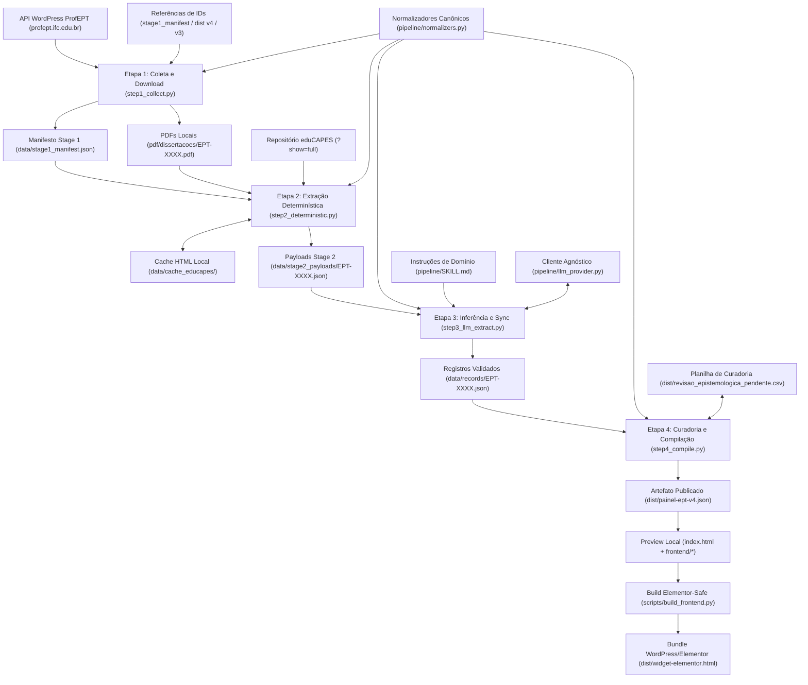

# Arquitetura e Governança — Pipeline & Painel ProfEPT v4

> **Escopo deste documento:** Visão executiva da arquitetura em 4 etapas + frontend modular, diagrama de fluxo de dados, mapa de diretórios/artefatos e regras de governança. Para detalhes de implementação interna e schemas Pydantic, consulte [DOCUMENTACAO_TECNICA.md](DOCUMENTACAO_TECNICA.md); para taxonomia de domínio, consulte [CONTRATO_DADOS.md](CONTRATO_DADOS.md).

---

## 1. Fluxo Geral de Dados

---

## 2. Estrutura Modular

* **Etapa 1 — Coleta e Pré-Extração (`pipeline/step1_collect.py`):** Consulta a API REST do WordPress do ProfEPT com acionamento manual via CLI, preserva IDs estáveis (`EPT-XXXX`) cruzando manifestos existentes, registra metadados brutos em `data/stage1_manifest.json` e baixa os PDFs em `pdf/dissertacoes/` com validação `%PDF-` e `SHA-256`. Não executa LLM nem OCR.
* **Etapa 2 — Extração Determinística (`pipeline/step2_deterministic.py`):** Extrai texto nativo dos PDFs via `pymupdf` (isolando capa, folha de rosto, ficha catalográfica, sumário, resumo, palavras-chave, introdução, trechos epistemológicos, referências citadas, `autores_referenciados` em ABNT e `coorientadores`), realiza scraping com cache local do eduCAPES (`?show=full`) e aplica classificadores determinísticos para Macroprojeto, Linha de Pesquisa e Tipo de Produto.
* **Etapa 3 — Inferência Semântica e Hidratação (`pipeline/step3_llm_extract.py` + `pipeline/llm_provider.py` + `pipeline/normalizers.py` + `pipeline/SKILL.md`):** Envia apenas um JSON compacto com os fragmentos relevantes (nunca o PDF inteiro) ao provedor configurado (`gemini`, `groq`, `mistral`, `openrouter` ou `ollama` local), aplica normalização canônica e trava de confiança (`RespostaInterpretativaLLM`) e hidrata `data/records/EPT-XXXX.json`. Inclui modo offline `--sync-deterministico`.
* **Etapa 4 — Curadoria Bidirecional e Compilação (`pipeline/step4_compile.py`):** Importa decisões humanas (`APROVADO` / `MANTER_NULO`) de `dist/revisao_epistemologica_pendente.csv` para `data/records/`, valida todos os registros contra `ContratoDefesaV4` e `PainelEptV4Output`, publica `dist/painel-ept-v4.json` e atualiza o CSV com as pendências restantes.
* **Frontend e Empacotamento Elementor (`index.html` + `frontend/` + `scripts/build_frontend.py`):** Mantém HTML, CSS e Vanilla JS separados para desenvolvimento local e compila `dist/widget-elementor.html` (autocontido, zero dependências externas, CSS 100% escopado em `#leme-painel-ept` e sem linhas em branco) para colagem no **Widget HTML (`</>`)** do Elementor.

---

## 3. Mapa de Diretórios e Artefatos

| Caminho | Rastreamento Git | Função no Sistema |
| :--- | :--- | :--- |
| [pipeline/](pipeline) | Rastreado | Módulos da pipeline (`models_v4.py`, `normalizers.py`, `llm_provider.py`, `step1`..`step4`) e prompt `SKILL.md`. |
| [frontend/](frontend) / [index.html](index.html) | Rastreado | Código-fonte modular do painel v4 (`styles.css`, `app.js` e `index.html` para preview HTTP local). |
| [scripts/build_frontend.py](scripts/build_frontend.py) | Rastreado | Compilador e validador zero-dependência que gera `dist/widget-elementor.html` (`--check`). |
| [dist/painel-ept-v4.json](dist/painel-ept-v4.json) | Rastreado | Catálogo bibliométrico final validado por `PainelEptV4Output` e consumido pelo frontend. |
| [dist/widget-elementor.html](dist/widget-elementor.html) | Rastreado | Artefato único compactado pronto para colagem no **Widget HTML (`</>`)** do Elementor. |
| [dist/revisao_epistemologica_pendente.csv](dist/revisao_epistemologica_pendente.csv) | Rastreado | Planilha bidirecional de curadoria humana (`;`, `UTF-8-SIG`) para bases pendentes. |
| [tests/test_pipeline_v4.py](tests/test_pipeline_v4.py) | Rastreado | Suíte de testes unitários offline (`unittest`). |
| [pyproject.toml](pyproject.toml) / [uv.lock](uv.lock) | Rastreado | Manifesto de dependências Python (`>=3.14`) gerenciado via `uv`. |
| `pdf/dissertacoes/` | Ignorado (`.gitignore`) | PDFs das dissertações baixados localmente (`EPT-XXXX.pdf`). |
| `data/stage1_manifest.json` | Ignorado (`.gitignore`) | Manifesto bruto da Etapa 1 (`Stage1ManifestV4`). |
| `data/cache_educapes/` | Ignorado (`.gitignore`) | Cache HTML local das páginas `?show=full` do eduCAPES (`capes_<id>.html`). |
| `data/stage2_payloads/` | Ignorado (`.gitignore`) | Payloads determinísticos da Etapa 2 (`ContratoExtracaoDeterministicaV4`). |
| `data/records/` | Ignorado (`.gitignore`) | Registros individuais consolidados na Etapa 3/4 (`ContratoDefesaV4`). |
| `.env` / `.venv/` | Ignorado (`.gitignore`) | Chaves locais de API e ambiente virtual gerenciado pelo `uv`. |

---

## 4. Regras de Governança e Invariantes

1. **Cardinalidade Fixa:** `1 Defesa = 1 Dissertação + 1 Produto Educacional` (`total_producoes = total_defesas * 2`).
2. **Vínculo Taxonômico Rígido:** O Macroprojeto (`MP1`..`MP6`) determina obrigatoriamente a Linha de Pesquisa (`MP1–MP3 → LP1`; `MP4–MP6 → LP2`) por regra determinística, sem inferência livre.
3. **Trava de Confiança e Vocabulário Canônico:** `base_epistemologica` exige evidência localizável (`secao`, `pagina`, `trecho`) e conformidade com o vocabulário canônico. Apenas candidatos com `confianca == "alta"` válidos preenchem `valor`; os demais mantêm `valor: null` e `revisao_pendente: true`.
4. **Proteção à Curadoria Humana:** Registros curados via CSV recebem `curado_humano: true` e nunca são sobrescritos por reexecuções padrão ou `--sync-deterministico` (exigindo `--sobrescrever --forcar-curados` para substituição explícita).
5. **Hierarquia de Fontes para Tipologia de Produto:** O formato específico declarado na dissertação/ficha do produto (`dissertacao_ficha`) prevalece sobre os metadados do eduCAPES (`educapes_dc_type`) e sobre a inferência assistida (`inferencia_llm`).
