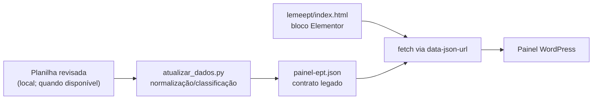
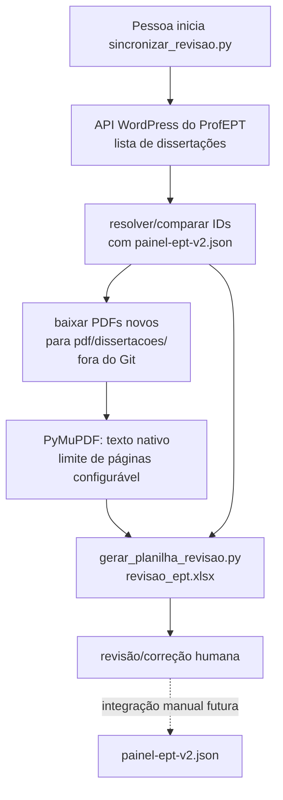
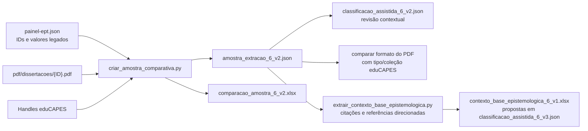
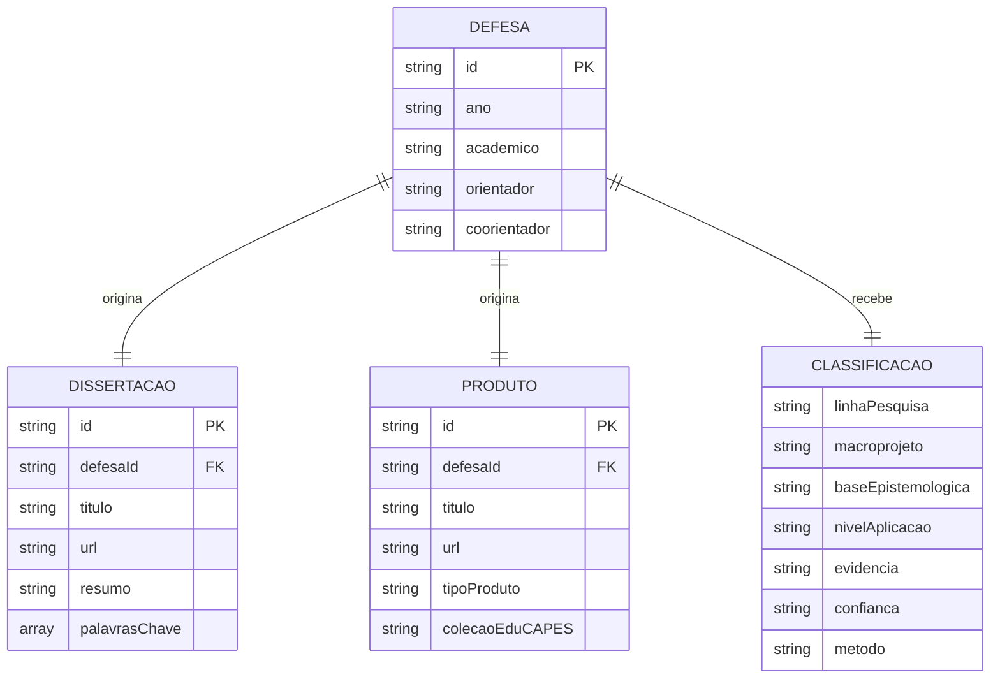
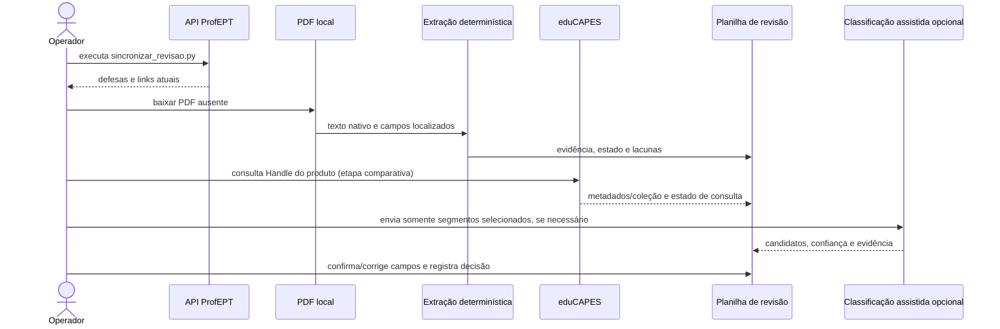

# Arquitetura e diagramas — LEME EPT

Este documento descreve o que existe hoje e separa as etapas planejadas. O fluxo novo é iniciado por uma pessoa; não há tarefa agendada, webhook nem sincronização automática em segundo plano.

## Fluxos implementados

### Atualizar/servir painel atual

`lemeept/index.html` é código para o widget HTML do Elementor, não uma página HTML independente. Preserve contêineres, seletores, `
`/` `, CSS isolado e inicialização do JavaScript. Não substitua o bloco pelo HTML renderizado/copiado do navegador.

### Descoberta e revisão visual

`sincronizar_revisao.py` consulta a API quando executado, mas não integra as decisões da planilha ao JSON. A chamada também não consulta eduCAPES nessa etapa. OCR e GPT não são acionados por esse comando.

### Extração comparativa da amostra

A amostra corrente usa seis IDs únicos: EPT-0001, 0003, 0005, 0007, 0008 e 0010. A extração usa texto nativo; a consulta eduCAPES pode falhar por Handle, rede ou mudança de HTML. Valores do `dc.type`/coleção não substituem o formato específico da dissertação.

## Entidades e chaves

`painel-ept-v2.json` mantém `defesas` e `producoes` em listas independentes; cada produção tem ID e `defesaId`. O JSON legado `painel-ept.json` continua separado durante a transição. Não migre o widget até validar o consumidor e a publicação no WordPress.

## Sequência de revisão de uma defesa

## Decisões técnicas estáveis

- Contagens: 110 defesas e 220 produções esperadas; cada produto conta uma vez; orientadores são contados por vínculo aluno–orientador único; coorientadores são separados.
- Macroprojeto é canônico pelo código MP1–MP6. `Macroprojeto 3` é alias de MP3, não uma categoria adicional.
- Linha de pesquisa deriva da relação oficial do macroprojeto: MP1–MP3 → LP1; MP4–MP6 → LP2.
- Base epistemológica é interpretativa. O texto da dissertação sustenta a classificação; autores e obras da bibliografia podem corroborar uma hipótese quando correspondem a citações/argumentos do referencial teórico.
- Classificação assistida de confiança alta pode ser usada como valor de trabalho; média/baixa, abstenção ou evidência contraditória seguem para conferência humana.
- Toda evidência preserva seção, página e trecho curto; registro da fonte não significa que ela declare literalmente o rótulo atribuído.

## Arquivos por responsabilidade

| Responsabilidade | Arquivos |
| --- | --- |
| Coleta e compatibilidade do fluxo antigo | `1_PegarDadosSiteIfc.py`, `2_PdfParaJson.py`, `3_ArrumarPlanilha.py`, `4_GerarPainelHtml.py` |
| Download local de PDFs | `baixar_dissertacoes.py`; corpus e manifesto em `pdf/dissertacoes/` (ignorados pelo Git) |
| Amostra de extração/eduCAPES | `criar_amostra_comparativa.py` |
| Evidência textual/bibliográfica de base epistemológica | `extrair_contexto_base_epistemologica.py` |
| Sincronização manual com API e planilha de lacunas | `sincronizar_revisao.py`, `gerar_planilha_revisao.py`, `GUIA_REVISAO.md` |
| JSON de transição | `lemeept/gerar_painel_v2.py`, `lemeept/pipeline/production_builder.py`, `lemeept/painel-ept-v2.json` |
| Painel legado e contrato legado | `lemeept/atualizar_dados.py`, `lemeept/pipeline/`, `lemeept/painel-ept.json`, `lemeept/index.html` |
| Vocabulários e identidades | `dados/referencia/` — preservar; não tratar como temporário |

## Pendências em ordem

1. Conferir os contextos bibliográficos gerados; calibrar citações que o regex não localiza e revisar a proposta alta de EPT-0007.
2. Refinar classificação do produto combinando formato declarado na dissertação com campos eduCAPES, sem equiparar coleção ampla a tipo.
3. Integrar decisões humanas da planilha ao JSON v2 de forma auditável.
4. Repetir o fluxo para uma defesa nova antes de automatizar publicação ou alterar o widget Elementor.

