# Diagramas do PAINEL EPT / LEME

Este documento complementa o guia de continuidade com uma visão visual do sistema.

O fluxo legado permanece organizado principalmente em scripts e funções. A nova pipeline usa `Registro` como dataclass e `GeradorPainel` para serialização; o diagrama representa responsabilidades e dependências, não todos os detalhes internos.

## Mapa para orientar as próximas mudanças

O projeto tem dois trechos distintos que não devem ser confundidos:

1. **Extração e preparação:** fontes ProfEPT/IFC e eduCAPES passam pela coleta, PDFs/OCR, classificação assistida e revisão humana até chegar à planilha final. É aqui que está o principal fluxo a revisar.
2. **Atualização do painel:** `lemeept/atualizar_dados.py` lê a planilha final revisada, normaliza/classifica os registros e grava `lemeept/painel-ept.json`. O `lemeept/index.html` é o bloco de código para o widget HTML do Elementor e busca o JSON por `data-json-url`.

### Fluxo de dados atual

```mermaid
flowchart LR
    subgraph coleta["1. Extração e preparação — fluxo a revisar"]
        SITE["Site ProfEPT / IFC"] --> COLETA["Coleta de trabalhos e metadados"]
        EDU["eduCAPES"] --> COLETA
        REFS["Referências e cache"] <--> COLETA
        COLETA --> PDFs["PDFs e planilha bruta"]
        PDFs --> OCR["OCR e extração de evidências"]
        OCR --> GPT["Classificação assistida / GPT"]
        GPT --> REV["Validação e revisão humana"]
        REV --> XLSX["dados/dados_finais_painel_ept.xlsx"]
    end

    subgraph painel["2. Preparação dos dados publicados"]
        XLSX --> UPD["lemeept/atualizar_dados.py"]
        UPD --> MAP["Mapeamento de colunas e normalização"]
        MAP --> CLASS["Preservar classificação revisada ou classificar"]
        CLASS --> BUILD["Contrato Registro + validação de IDs"]
        BUILD --> JSON["lemeept/painel-ept.json"]
    end

    subgraph wordpress["3. Exibição — Elementor / WordPress"]
        WIDGET["Widget HTML do Elementor\nlemeept/index.html"] --> FETCH["fetch via data-json-url"]
        JSON --> FETCH
        FETCH --> UI["Filtros, busca, gráficos, tabela/cards"]
        UI --> WP["Página publicada no WordPress"]
    end
```

### Fronteira cuidadosa do Elementor

`lemeept/index.html` contém código para ser inserido em um **widget HTML do Elementor**. Embora esteja salvo como `.html`, não é uma página independente: CSS, elementos e JavaScript dependem do escopo/estrutura do widget e da integração WordPress. Alterações visuais devem preservar o contêiner `#leme-painel-ept`, os IDs/classes usados pelo JavaScript, o carregamento JSON por `data-json-url` e o isolamento dos estilos. Antes de trocar o bloco publicado, conferir o diff e validar no editor e na página publicada.

| Tipo de mudança | Ponto inicial recomendado | Cuidado principal |
| --- | --- | --- |
| Mudar de onde vêm os dados ou como são coletados | Scripts de coleta/OCR e `dados/referencia/` | Não alterar junto o contrato do painel sem necessidade; preservar IDs e trilha de revisão. |
| Mudar colunas, limpeza ou classificação antes do painel | `lemeept/atualizar_dados.py` e `lemeept/pipeline/` | Manter os nomes/tipos de campos esperados no JSON. |
| Mudar filtros, gráficos, layout ou exibição | `lemeept/index.html` | Tratar como código de widget Elementor; preservar seletores, escopo CSS e inicialização JS. |
| Mudar campos disponíveis no painel | Pipeline e `index.html` em conjunto | Conferir o contrato de `Registro`, regenerar JSON e verificar renderização. |

## Requisitos do próximo desenho

Estes itens descrevem o **estado desejado** e não afirmam que já estejam implementados.

### Extração unificada e pesquisa direcionada

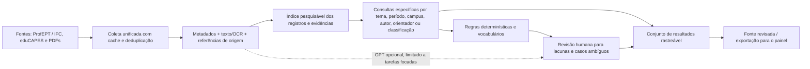

Objetivos de projeto: reduzir etapas duplicadas e dependência de GPT; manter buscas específicas reproduzíveis; guardar de onde veio cada evidência; e enviar à revisão humana apenas o que regras e dados disponíveis não resolverem com segurança. A escolha do mecanismo de índice e o formato exato das consultas ainda são decisões de implementação.

### Produção como unidade independente

O total de **220** deve representar produções acessíveis individualmente, e não defesas multiplicadas pela presença de um produto. O modelo alvo separa a entidade que agrupa uma defesa/trabalho da entidade que representa cada produção:

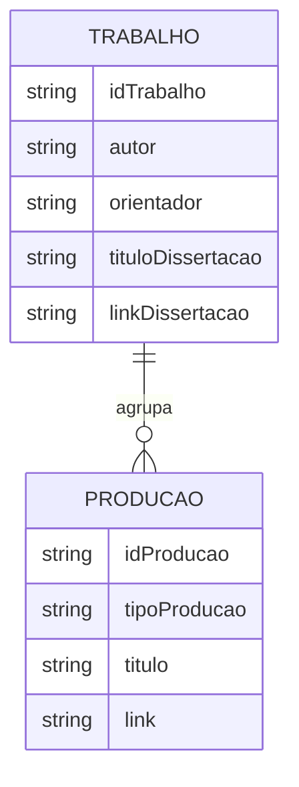

Uma dissertação e seu produto educacional podem ser duas produções ligadas ao mesmo trabalho, cada uma com identidade, tipo, título e acesso próprios. O total do painel conta entidades `PRODUCAO`; métricas de pessoas e relacionamentos devem usar identidades normalizadas/deduplicadas no nível de `TRABALHO` ou do vínculo, não somas das produções. Por consequência, número de alunos orientados não pode crescer porque o mesmo aluno tem dissertação e produto, e totais por tipo de produto não podem contar o mesmo produto mais de uma vez.

### Linhas e macroprojetos

- Dar destaque visual às **linhas de pesquisa** no painel e oferecer leitura/consulta própria, além de mantê-las como filtro/classificação dos registros.
- Tratar **“Macroprojeto 3”** e **“MP3”** como categorias distintas a partir da divisão informada. Não fundir por semelhança textual nem reclassificar registros históricos automaticamente. A regra de vigência, os rótulos oficiais e como atribuir registros anteriores devem ser definidos antes da migração.
- Ao alterar agregações, documentar a unidade de cada indicador (produção, trabalho/aluno, orientador único, produto único) para evitar que um gráfico some entidades diferentes.

## 1. Visão geral do fluxo

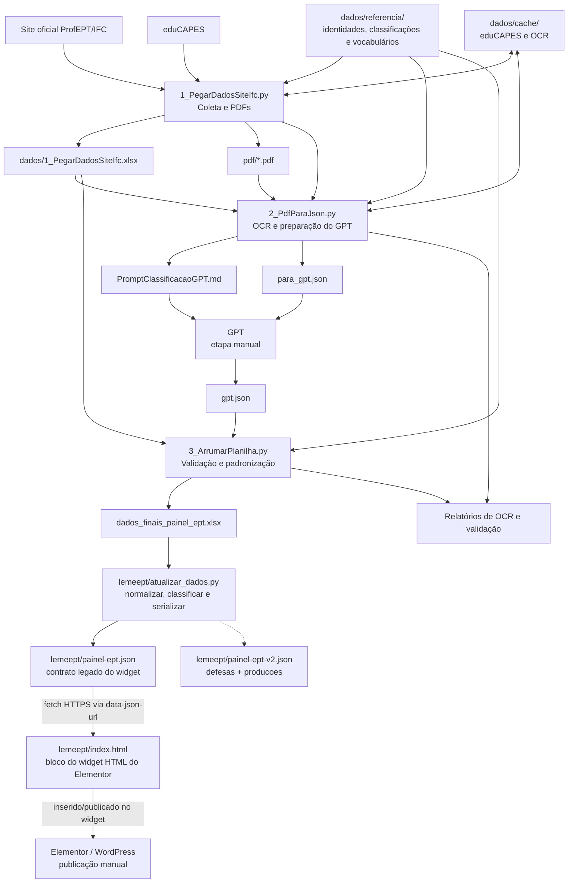

O contrato legado `painel-ept.json` continua alimentando o widget Elementor. `painel-ept-v2.json` é uma saída de transição com arrays independentes `defesas` e `producoes`; cada produção tem ID próprio e `defesaId`. O widget não consome o v2 até uma migração deliberada e validada no WordPress.

## 2. Diagrama de classes conceitual

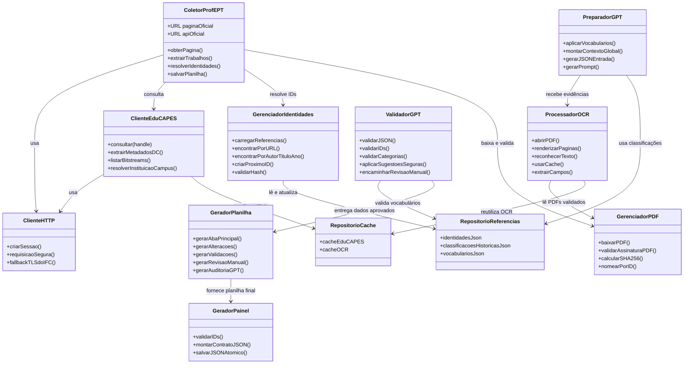

## 3. Modelo conceitual dos dados

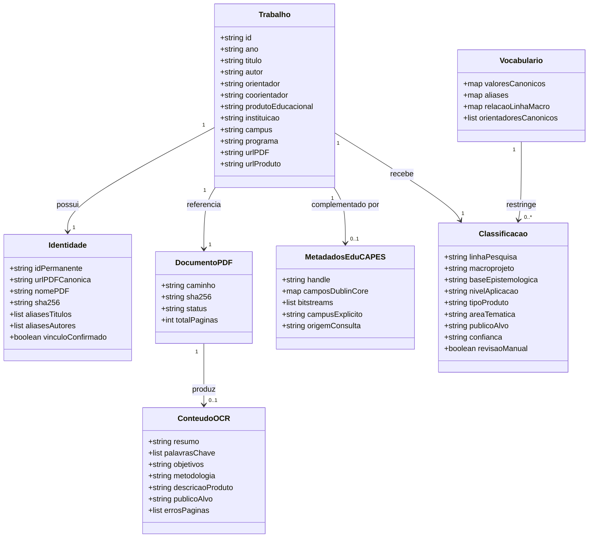

## 4. Diagrama de sequência da execução normal

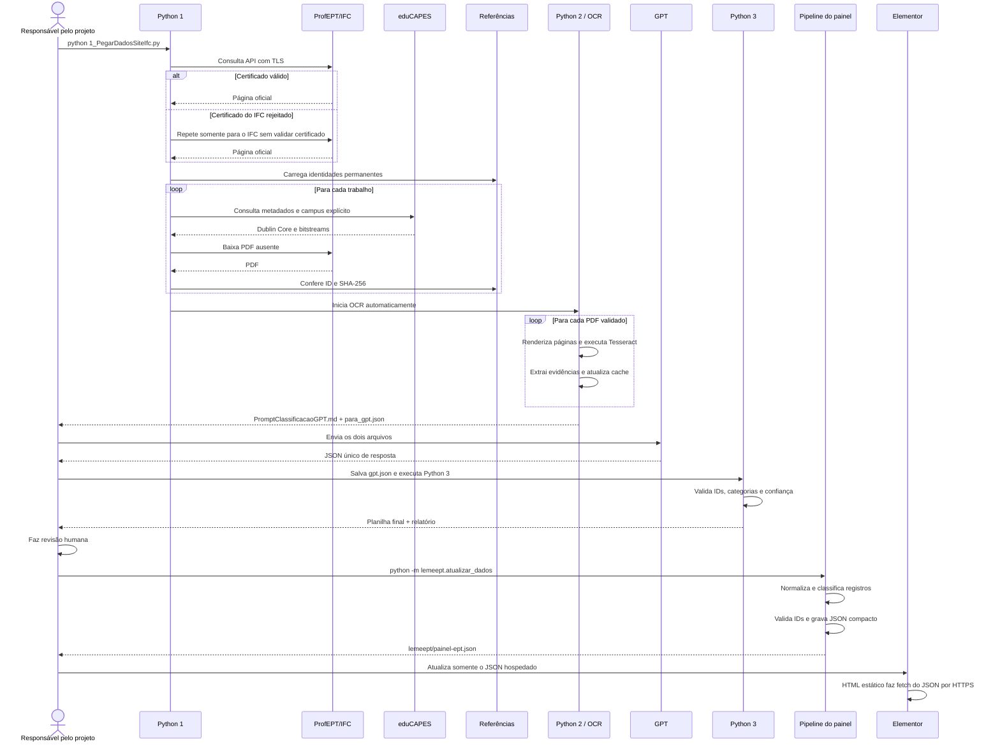

## 5. Decisão da instituição e do campus

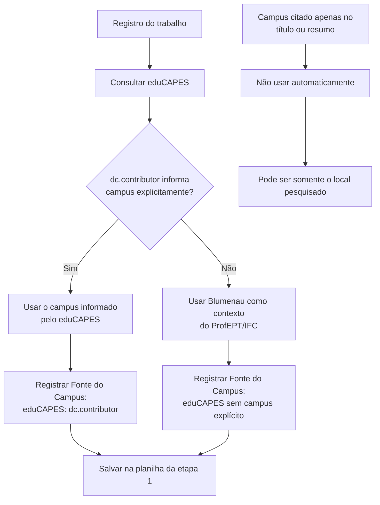

## 6. Decisão de conexão TLS e download

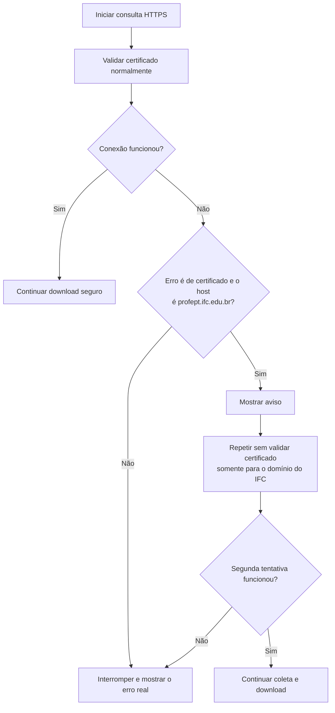

## 7. Ciclo de vida dos arquivos

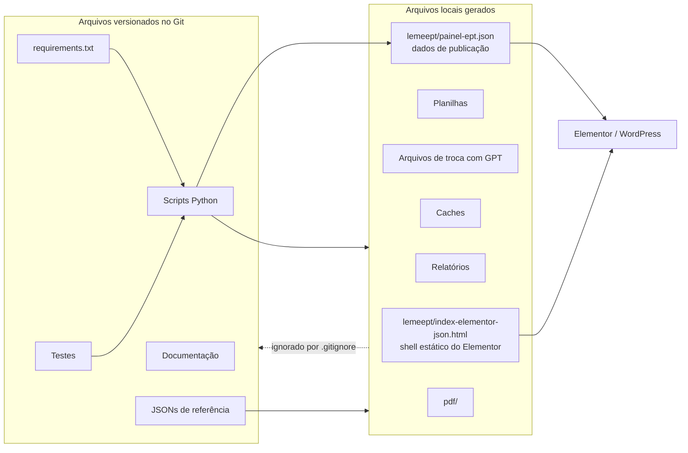

## 8. Dependências técnicas

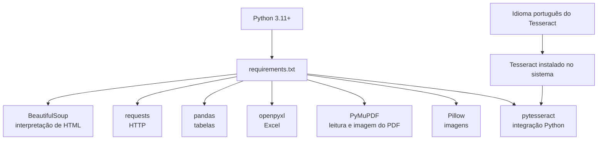

O `requirements.txt` instala as bibliotecas Python. O Tesseract e seu pacote de idioma são dependências externas e precisam ser instalados no sistema operacional.

