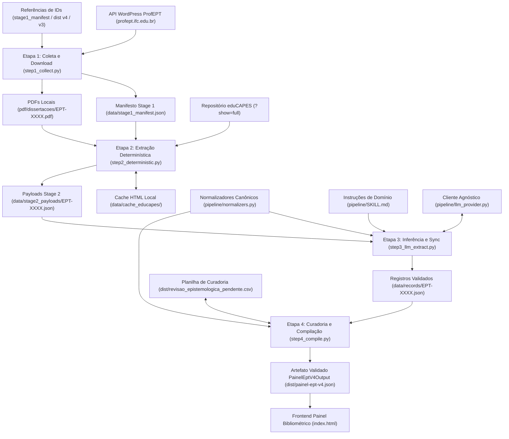

# Documentação Técnica — Pipeline LEME / ProfEPT v4

> **Escopo deste documento:** Especificação técnica atualizada e fiel ao comportamento **em vigor** na pasta [pipeline/](pipeline), validada pela suíte de testes em [tests/test_pipeline_v4.py](tests/test_pipeline_v4.py) e confrontada com [RELATORIOS.md](RELATORIOS.md) e com os artefatos compilados em `data/` e `dist/`.
>
> O histórico da auditoria e das 25 correções aplicadas na refatoração (`AUD-01` a `AUD-25`) está registrado em [AUDITORIA_E_REFATORACAO.md](AUDITORIA_E_REFATORACAO.md).

---

## 1. Visão Geral e Princípios Arquiteturais

A **Pipeline v4** do projeto **LEME / ProfEPT** automatiza a coleta, extração determinística, classificação semântica assistida por LLM, normalização canônica, curadoria humana e compilação bibliométrica das defesas do Programa de Pós-Graduação em Educação Profissional e Tecnológica (**ProfEPT — IFC Campus Blumenau**).

### Métricas Atuais do Acervo Compilado (`dist/painel-ept-v4.json`)

* **Volume catalogado:** **111 defesas** (`EPT-0001` a `EPT-0111`), cobrindo o período de **2020 a 2026** (`2020: 24`, `2021: 6`, `2022: 6`, `2023: 12`, `2024: 36`, `2025: 21`, `2026: 6`).
* **Cardinalidade fixa:** **1 Defesa = 1 Dissertação + 1 Produto Educacional**, totalizando **222 produções** (`total_producoes = total_defesas * 2`).
* **Distribuição por Linha de Pesquisa:** `LP1` = 64 defesas; `LP2` = 47 defesas (`MP1: 23`, `MP2: 15`, `MP3: 26`, `MP4: 14`, `MP5: 11`, `MP6: 22`).
* **Cobertura determinística:**
  * `dissertacao.autores_referenciados`: **108/111** preenchidos (apenas os 3 PDFs sem camada de texto legível permanecem vazios: `EPT-0059`, `EPT-0072` e `EPT-0073`).
  * `dissertacao.resumo`: **107/111** preenchidos, **0** com marcador `[PÁG. X]` residual.
  * `dissertacao.palavras_chave`: **107/111** preenchidas; `produto.palavras_chave`: **111/111** preenchidas.
* **Status da base epistemológica e produtos:**
  * `base_epistemologica.valor`: **60** registros aprovados com vocabulário 100% canônico (`Materialismo Histórico-Dialético: 43`, `Pedagogia Histórico-Crítica: 15`, `Educação Libertadora / Freireana: 1`, `Aprendizagem Significativa: 1`) e **51** registros pendentes (`confianca == "media"`, `revisao_pendente == true`) exportados para [dist/revisao_epistemologica_pendente.csv](dist/revisao_epistemologica_pendente.csv).
  * `produto.nivel_aplicacao`: **7 rótulos canônicos** (`Ensino Médio Integrado: 75`, `Educação Superior: 17`, `Curso Técnico Subsequente: 10`, `EJA / PROEJA: 4`, `Educação Profissional e Tecnológica: 3`, `Gestão Institucional: 1`, `Ensino Fundamental: 1`).
  * `produto.proveniencia.fonte_tipo_escolhida`: `dissertacao_ficha: 96`, `inferencia_llm: 15`.

### Princípios de Design

1. **Execução sob demanda via CLI (sem daemon):** O operador aciona cada etapa manualmente via `python -m pipeline.<etapa>`.
2. **Extração determinística primeiro:** Coleta DOM, validação `%PDF-`/`SHA-256`, PyMuPDF, scraping eduCAPES e classificadores regex executam antes de qualquer chamada à LLM (Etapas 1 e 2).
3. **Recorte cirúrgico para contexto enxuto (~8k tokens):** A Etapa 3 envia apenas um JSON compacto (`montar_prompt_enxuto`) com média empírica de **~7.104 tokens** de entrada (máximo **~8.853 tokens** somando `pipeline/SKILL.md` + payload do usuário, estimativa ~4 chars/token) e exige saída JSON estruturada de ~400–500 tokens (`RespostaInterpretativaLLM`).
4. **Validação estrita via Pydantic v2:** Todas as fronteiras entre etapas — inclusive o envelope de publicação `PainelEptV4Output` — são validadas em [pipeline/models_v4.py](pipeline/models_v4.py).
5. **Normalização canônica + Trava de confiança:** [pipeline/normalizers.py](pipeline/normalizers.py) padroniza bases epistemológicas, níveis de aplicação, palavras-chave e resumo público. Apenas bases canônicas com `confianca == "alta"` e evidência localizável preenchem `valor`; demais casos seguem para curadoria.
6. **Persistência granular + Proteção à curadoria:** Cada defesa persiste em `data/records/EPT-XXXX.json`. Registros curados via CSV recebem `curado_humano: true` e são protegidos contra sobrescrita na Etapa 3 (bem como preservados na ressincronização `--sync-deterministico`).

---

## 2. Arquitetura e Fluxo de Dados



### Mapa de Diretórios e Artefatos

| Caminho | Rastreamento Git | Função no Fluxo |
| :--- | :--- | :--- |
| [pipeline/](pipeline) | Rastreado | Módulos Python (`models_v4.py`, `normalizers.py`, `llm_provider.py`, `step1`..`step4`) e prompt `SKILL.md`. |
| [tests/test_pipeline_v4.py](tests/test_pipeline_v4.py) | Rastreado | Suíte de testes unitários offline (`unittest`, 19 testes cobrindo Etapas 1–4, normalizadores e provedor LLM). |
| [pyproject.toml](pyproject.toml) / [uv.lock](uv.lock) | Rastreado | Manifesto de dependências Python (`>=3.14`) gerenciado via `uv`. |
| [painel-ept-v3.json](painel-ept-v3.json) | Rastreado | Fallback legado (110 defesas) usado na resolução de IDs quando manifestos v4 não existem. |
| [dist/painel-ept-v4.json](dist/painel-ept-v4.json) | Rastreado | Artefato final consolidado validado por `PainelEptV4Output` e consumido pelo frontend v4. |
| [dist/revisao_epistemologica_pendente.csv](dist/revisao_epistemologica_pendente.csv) | Rastreado | Fila de curadoria humana (ponto e vírgula, `UTF-8-SIG`) para registros com `revisao_pendente == true`. |
| [index.html](index.html) | Rastreado | Widget HTML/CSS/JS v4 consolidado (usa `./dist/painel-ept-v4.json` localmente via `data-json-url-local` e URL pública via `data-json-url`). |
| [index-v3.html](index-v3.html) | Rastreado | Widget legado v3 preservado (consumindo `painel-ept.json`). |
| `pdf/dissertacoes/` | Ignorado (`.gitignore`) | PDFs baixados localmente (`EPT-0001.pdf` .. `EPT-0111.pdf`). |
| `data/stage1_manifest.json` | Ignorado (`.gitignore`) | Saída da Etapa 1 (`Stage1ManifestV4`). |
| `data/cache_educapes/` | Ignorado (`.gitignore`) | Cache HTML local das páginas `?show=full` do eduCAPES (`capes_<id>.html`, 110 arquivos únicos). |
| `data/stage2_payloads/` | Ignorado (`.gitignore`) | Saída da Etapa 2 (`ContratoExtracaoDeterministicaV4`, 111 JSONs). |
| `data/records/` | Ignorado (`.gitignore`) | Saída da Etapa 3 / fonte da Etapa 4 (`ContratoDefesaV4`, 111 JSONs). |
| `.env` / `.venv/` | Ignorado (`.gitignore`) | Segredos locais de provedores LLM e ambiente virtual Python. |

---

## 3. Stack, Dependências e Configuração de Ambiente

### Ambiente Python (`pyproject.toml`)

* **Versão do Python:** `>=3.14` (gerenciamento via `uv` com ambiente em `.venv/`).
* **Dependências declaradas:**
  * `pydantic==2.14.3` — definição e validação estrita de todos os contratos e do envelope final.
  * `pymupdf==2.1` (`import pymupdf`) — leitura nativa de texto dos PDFs página a página.
  * `requests==2.34.2` e `urllib3==2.8.0` — consumo da API WordPress, download de PDFs e scraping do eduCAPES.
  * `beautifulsoup4==4.15.0` — parsing HTML da página WordPress e dos metadados Dublin Core do eduCAPES.
  * `google-genai>=3.3.0` (`from google import genai`) — SDK oficial para provedor `gemini`.
  * `openai==3.50.0` — cliente OpenAI-compatível usado para `groq`, `openrouter`, `mistral` e `ollama`.
  * `python-dotenv==1.2.4` — carregamento determinístico de `.env` ancorado na raiz do repositório (`PROJECT_ROOT / ".env"`).

### Variáveis de Ambiente (`pipeline/llm_provider.py` e `.env.dev`)

O comportamento da Etapa 3 é controlado por variáveis lidas em [LLMClient](pipeline/llm_provider.py#L95-L168):

| Variável | Padrão por Provedor | Descrição |
| :--- | :--- | :--- |
| `LLM_PROVIDER` | `"groq"` | Seleciona o backend: `gemini`, `groq`, `openrouter`, `mistral` ou `ollama`. |
| `LLM_MODEL` | `gemini`: `gemini-2.5-flash`<br>`groq`: `llama-3.3-70b-versatile`<br>`openrouter`: `meta-llama/llama-3.3-70b-instruct:free`<br>`mistral`: `mistral-small-latest`<br>`ollama`: `qwen2.5:7b-instruct` | Identificador do modelo enviado na chamada da API. |
| `LLM_DELAY` | `gemini`: `4.2`<br>`groq`: `5.0`<br>`openrouter`: `4.5`<br>`mistral`: `2.0`<br>`ollama`: `0.0` | Pausa em segundos aplicada após cada requisição bem-sucedida. |
| `LLM_BASE_URL` | `groq`: `https://api.groq.com/openai/v1`<br>`openrouter`: `https://openrouter.ai/api/v1`<br>`mistral`: `https://api.mistral.ai/v1`<br>`ollama`: `http://localhost:11434/v1` | Endpoint base para clientes OpenAI-compatíveis. |
| `GEMINI_API_KEY` / `GROQ_API_KEY` / `OPENROUTER_API_KEY` / `MISTRAL_API_KEY` / `LLM_API_KEY` | `"ollama"` (para `ollama` local) | Chaves de autenticação por provedor (com fallback para `LLM_API_KEY`). |
| `LLM_THINKING_BUDGET` | `None` (opcional, int) | Configura `types.ThinkingConfig(thinking_budget=...)` no provedor `gemini` (ex.: `0` para desativar *thinking*). |
| `LLM_NUM_CTX` | `None` (opcional, int) | Enviado via `extra_body={"options": {"num_ctx": ...}}` no provedor `ollama` (ex.: `8192`). |
| `LLM_THINK` | `None` (opcional, bool) | Enviado via `extra_body={"think": ...}` no provedor `ollama` (ex.: `false` em GPUs de 8 GB VRAM). |

---

## 4. Contratos de Dados (`pipeline/models_v4.py`)

Todos os schemas residem em [pipeline/models_v4.py](pipeline/models_v4.py), com timestamps padrão unificados em **ISO-8601 UTC** (`datetime.now(timezone.utc).isoformat()`).

### Tipos Canônicos (`Literal`)

* **`LinhaPesquisaCode`:** `"LP1" | "LP2"`
* **`MacroprojetoCode`:** `"MP1" | "MP2" | "MP3" | "MP4" | "MP5" | "MP6"`
* **`TipoProdutoSlug` (9 tipos CAPES):** `"material_didatico_instrucional"`, `"curso_oficina"`, `"tecnologia_social"`, `"software_aplicativo"`, `"eventos_organizados"`, `"acervo"`, `"produto_comunicacao"`, `"manual_protocolo"`, `"carta_mapa"`
* **`PublicoAlvoSlug` (5 grupos):** `"docentes_professores"`, `"estudantes_alunos"`, `"gestores_coordenadores"`, `"tecnicos_profissionais_educacao"`, `"comunidade_externa"`
* **`ConfiancaEpistemologica`:** `"alta" | "media" | "baixa" | "abstencao"`
* **`FonteTipoProduto`:** `"dissertacao_ficha" | "educapes_dc_type" | "inferencia_llm"`

### Contrato 1 — Manifesto de Pré-Extração (`Stage1ManifestV4`)

Gerado por `step1_collect.py` em `data/stage1_manifest.json`:

* **`Stage1ManifestV4`**: `schema_version: str = "4.0"`, `gerado_em: str`, `total_registros: int`, `registros: List[PreExtracaoItemV4]`.
* **`PreExtracaoItemV4`**: `id: str` (padrão `^EPT-[0-9]{4}$`), `coletado_em: str`, `fonte_profept: FonteProfeptV4`, `arquivos: ArquivosDefesaV4`.
* **`FonteProfeptV4`**: `titulo_bruto: str`, `autor_bruto: str`, `orientador_bruto: Optional[str] = None`, `ano: int`, `campus: str = "IFC Blumenau"`, `url_dissertacao: str`, `titulo_produto_bruto: Optional[str] = None`, `handle_educapes: Optional[str] = None`.
* **`ArquivosDefesaV4`**: `pdf_dissertacao_path: str`, `sha256_dissertacao: str`, `pdf_produto_path: Optional[str] = None`, `status_download: Literal["OK", "ERRO_HTTP", "CORROMPIDO"]`.

### Contrato 2 — Payload Determinístico (`ContratoExtracaoDeterministicaV4`)

Gerado por `step2_deterministic.py` em `data/stage2_payloads/EPT-XXXX.json`:

* **`ContratoExtracaoDeterministicaV4`**: `id: str`, `metadados_resolvidos: MetadadosResolvidos`, `dissertacao_deterministica: DissertacaoDeterministica`, `evidencias_educapes: EvidenciasEduCAPES`, `recortes_textuais: RecortesTextuais`.
* **`MetadadosResolvidos`**: `ano: int`, `autor: str`, `orientador: str`, `coorientadores: List[str]`, `instituicao: str = "Instituto Federal Catarinense (IFC)"`, `campus: str = "IFC Blumenau"`, `linha_pesquisa: str` *(aceita `"LP_INDEFINIDA"`)*, `macroprojeto: str` *(aceita `"MP_INDEFINIDO"`)*.
* **`DissertacaoDeterministica`**: `titulo: str`, `link: str`, `palavras_chave: List[str]`, `autores_referenciados: List[str]`.
* **`EvidenciasEduCAPES`**: `handle_url: Optional[str]`, `titulo_produto: Optional[str]`, `titulo_produto_bruto: Optional[str]`, `data_publicacao: Optional[str]`, `autores_colaboradores: List[AutorColaboradorV4]`, `identificadores: List[IdentificadorProdutoV4]`, `colecao_educapes: Optional[str]`, `dc_type_educapes: List[str]`, `palavras_chave_educapes: List[str]`, `tipo_produto_regex: Optional[str]`, `fonte_tipo_regex: Optional[FonteTipoProduto]`.
  * **Restrição estrita:** `AutorColaboradorV4` e `IdentificadorProdutoV4` utilizam `ConfigDict(extra="forbid")`.
* **`RecortesTextuais`**: `capa: str`, `ficha_catalografica: str`, `sumario: str`, `resumo: str`, `introducao: str`, `descricao_produto_na_dissertacao: str`, `trechos_epistemologicos: List[TrechoEpistemologico]`, `referencias_filtradas: List[str]`.

### Contrato Intermediário da LLM (`RespostaInterpretativaLLM`)

Schema enxuto imposto à saída da LLM em `step3_llm_extract.py`:

* **`RespostaInterpretativaLLM`**: `macroprojeto: MacroprojetoCode`, `produto_titulo: str`, `produto_tipo: TipoProdutoSlug`, `produto_publico_alvo: List[PublicoAlvoSlug]`, `produto_nivel_aplicacao: str`, `base_epistemologica: BaseEpistemologicaLLM`.
* **`BaseEpistemologicaLLM`**: `valor: Optional[str]`, `candidato: Optional[str]`, `confianca: ConfiancaEpistemologica`, `justificativa: str`, `evidencias: List[EvidenciaCurtaLLM]` (`secao`, `pagina`, `trecho_curto`, `referencia_correspondente`).

### Contrato 3 — Registro Final e Envelope de Publicação (`ContratoDefesaV4` / `PainelEptV4Output`)

* **`ContratoDefesaV4`**: `schema_version: str = "4.0"`, `id: str` (`^EPT-[0-9]{4}$`), `ano: int`, `autor: str`, `orientador: str`, `coorientadores: List[str]`, `instituicao: str`, `campus: str`, `linha_pesquisa: LinhaPesquisaCode`, `macroprojeto: MacroprojetoCode`, `dissertacao: DissertacaoFinalV4`, `produto: ProdutoFinalV4`, `indice_busca: IndiceBuscaV4`.
* **`BaseEpistemologicaV4`**: `valor: Optional[str]`, `candidato: Optional[str]`, `confianca: ConfiancaEpistemologica`, `revisao_pendente: bool`, `curado_humano: bool = False`, `justificativa: str`, `evidencias: List[EvidenciaEpistemologicaV4]`.
* **`ProdutoFinalV4`**: `titulo: str`, `tipo: TipoProdutoSlug`, `link: Optional[str]`, `publico_alvo: List[PublicoAlvoSlug]`, `nivel_aplicacao: str`, `palavras_chave: List[str]`, `data_publicacao: Optional[str]`, `autores_colaboradores: List[AutorColaboradorV4]`, `identificadores: List[IdentificadorProdutoV4]`, `proveniencia: ProvenienciaProdutoV4` (`fonte_tipo_escolhida`, `rotulo_original_declarado`, `colecao_educapes`, `dc_type_educapes`).
* **`IndiceBuscaV4`**: `texto_busca_normalizado: str`, `termos_unificados: List[str]`, `tem_produto_vinculado: bool`, `tem_resumo: bool`.
* **`PainelEptV4Output`** ([pipeline/models_v4.py](pipeline/models_v4.py#L250-L256)): `schema_version: str = "4.0"`, `gerado_em: str`, `total_defesas: int`, `total_producoes: int`, `defesas: List[ContratoDefesaV4]`.

---

## 5. Especificação Técnica por Módulo

### 5.1. Etapa 1 — Coleta e Pré-Extração (`pipeline/step1_collect.py`)

* **Fonte e TLS:** Consulta `https://profept.ifc.edu.br/wp-json/wp/v2/pages?slug=dissertacoes` com `SSL_VERIFY = False` (supressão explícita de `InsecureRequestWarning`).
* **Parser sequencial independente de DOM (`extrair_defesas_do_html`):** Percorre tags em fluxo contínuo ignorando containers pai (`ul`, `li`, `p`), delimita cada defesa por `Acadêmico/Discente/Autor:`, resolve o ano via cabeçalhos `DEFESAS 20XX` com fallback na URL do PDF e preserva `titulo_produto_bruto` e `handle_educapes`.
* **Estabilidade de IDs multi-referência (`carregar_mapeamento_ids_existentes`):** Lê em ordem de prioridade `[data/stage1_manifest.json, dist/painel-ept-v4.json, painel-ept-v3.json]`, preservando o primeiro ID mapeado por URL ou autor normalizado, processando `reversed(fontes)` para numeração cronológica de novas defesas e ordenando o manifesto por `id`.
* **Download e integridade:** Reaproveita PDFs locais válidos (`st_size > 1024` e cabeçalho `b"%PDF-"`), valida assinatura mágica após download via streaming e calcula `SHA-256`.
* **CLI (`--saida`, `--pdfs-dir`, `--ref-ids`):** Permite personalizar destinos e listas de referência sem editar código.

### 5.2. Etapa 2 — Extração Determinística (`pipeline/step2_deterministic.py`)

* **Sanitização e leitura (`ler_paginas_pdf` / `normalizar_espacos`):** Remove caracteres invisíveis/de controle (`\u200b`–`\u200f`, `\x00`–`\x1f`, etc.) preservando quebras legíveis.
* **Detecção taxonômica integral (`detectar_macroprojeto_e_linha`):**
  1. Normaliza o texto completo do PDF (`txt_limpo`) e gera versão condensada sem separadores (`txt_colado`).
  2. Busca assinaturas explícitas (`Macroprojeto 1..6 / I..VI`, `MP1..3`, `MP5..6`). Para `MP4`, aplica varredura sensível ao contexto sobre `(?<!\.)\bmp\s*[-]?\s*(4)\b`, descartando extensões `.mp4`, prefixos (`formato`, `arquivo`, `extensao`, `video`, `audio`, `midia`, `em`) e sufixos técnicos (`padrao`, `formato`, `video`, `mb`, etc.).
  3. Busca pelos títulos canônicos dos 6 macroprojetos (espaçado e colado) e aplica fallback para Linha de Pesquisa (`LP1` / `LP2`) antes de retornar `MP_INDEFINIDO` / `LP_INDEFINIDA`.
* **Isolamento cirúrgico de seções (`isolar_secoes_pdf` -> `(RecortesTextuais, texto_refs)`):**
  * Retorna `(RecortesTextuais(), "")` para PDF vazio.
  * Janela de pré-textuais em `paginas[:18]`; captura `RESUMO` com extensão automática para a página seguinte quando `Palavras-chave` anteceder `ABSTRACT` (`<= 4500` chars).
  * `extrair_palavras_chave_resumo` aceita variações `Palavras-chave`, `Palavras-chaves` e `Palavras Chave` com separadores `;`, `.` ou `,`.
  * Ignora páginas de sumário via `_eh_pagina_sumario` (`SUMÁRIO` ou `>= 3` sequências `....`).
  * Localiza `idx_refs` após a Introdução com `_PADRAO_REFS` (aceitando numeração opcional, `REFERÊNCIAS [BIBLIOGRÁFICAS/BIBLOGRÁFICAS/CONSULTADAS]`, `BIBLIOGRAFIA [/ FONTES DE REFERÊNCIA]` e `OBRAS QUE EMBASARAM`, em caixa alta ou Title Case, inclusive no meio da página, fatiando `texto_refs` a partir de `match.start()`).
* **Extração ABNT de autores referenciados (`extrair_autores_referencias`):** Suporta acentuação maiúscula completa (`À–Ý`), remove partículas iniciais (`PARTICULAS_SOBRENOME`) e agnomes finais (`AGNOMES`: `JUNIOR`, `FILHO`, `NETO`, etc.), descarta stopwords institucionais/editoriais expandidas (`IGNORAR_ENTRADAS_REF`) e preserva sobrenomes compostos reais (até 2 tokens, ex.: `"Espírito Santo"`).
* **Scraping eduCAPES e classificação com proveniência (`coletar_evidencias_educapes` + `classificar_produto_com_fonte`):**
  * Mantém comportamento idêntico com ou sem `handle_url` (usando `extrair_sentenca_produto(resumo_pdf)` e `extrair_sentenca_produto(descricao_produto_pdf)` em ambos os fluxos).
  * Cacheia `?show=full` em `data/cache_educapes/` e deduplica `dc_types`, `autores_colaboradores` e `identificadores` entre `<meta>` e `<table>`.
  * `REGRAS_TIPO_PRODUTO` está alinhada à taxonomia de `SKILL.md` e `CONTRATO_DADOS.md` (`podcast`, `ava`, `moodle`, `website`, `site educativo`, `blog`, `material de apoio`, `folder educativo` e `portfólio formativo` classificados em `material_didatico_instrucional`; `software_aplicativo` restrito a software/app/sistema web/simulador/plataforma virtual; `REGRAS_DC_TYPE_EDUCAPES` aplica apenas tags não ambíguas como `aplicativo móvel`, `software`, `curso`, `podcast`, `jogo`).
  * Retorna `(tipo_regex, fonte_tipo_regex)` distinguindo `"dissertacao_ficha"` de `"educapes_dc_type"`.
* **CLI (`--manifesto`, `--saida-dir`, `--cache-dir`, `--id`):** Suporta execução integral ou filtrada por ID.

### 5.3. Normalizadores Canônicos (`pipeline/normalizers.py`)

* `normalizar_texto_busca`: NFKD sem acentos, minúsculo e alfanumérico.
* `limpar_palavras_chave`: remove pontuação residual nas pontas e deduplica por chave normalizada.
* `limpar_resumo_publico`: remove marcas `[PÁG. X]` e título `RESUMO` antes da gravação em `dissertacao.resumo`.
* `normalizar_base_epistemologica`: mapeia termos e aliases para as 7 matrizes canônicas (suportando composições válidas entre matrizes canônicas ligadas por `" e "` / `,` / `;` / `+` / `/`), retornando `(termo_normalizado, eh_canonico)`.
* `normalizar_nivel_aplicacao`: padroniza variações e slugs `snake_case` nos rótulos legíveis definidos em `SKILL.md`.

### 5.4. Provedor Modular de LLM (`pipeline/llm_provider.py`)

* Carrega `.env` a partir de `PROJECT_ROOT / ".env"`.
* Suporta `gemini`, `groq`, `openrouter`, `mistral` e `ollama` (com lookup seguro pelo nome da variável em `env_key` e fallback `LLM_API_KEY`).
* Sanitiza JSON Schemas para Gemini (`_limpar_schema_gemini`) e para APIs OpenAI-compat (`_resolver_refs_schema`, com `strict: True` em `groq`, `mistral` e `ollama`, e `json_object` + schema no prompt para `openrouter`).
* Suporta `LLM_THINKING_BUDGET` (Gemini `ThinkingConfig`) e `LLM_NUM_CTX` / `LLM_THINK` (`extra_body` no Ollama).
* Implementa backoff exponencial com saída imediata na última tentativa em `RateLimitError`, `OpenAIAPIError` e `GeminiAPIError`.

### 5.5. Etapa 3 — Inferência, Hidratação e Ressincronização (`pipeline/step3_llm_extract.py` + `pipeline/SKILL.md`)

* `pipeline/SKILL.md` instrui o modelo estritamente sobre o JSON compacto de entrada (`montar_prompt_enxuto`, incluindo `linha_pesquisa_pre_detectada`) e o schema de saída `RespostaInterpretativaLLM` (`trecho_curto` `<= 180` chars, `justificativa` `<= 2` frases, vocabulário canônico de bases e níveis).
* `montar_registro_final` impõe `MP -> LP`, aplica `normalizar_base_epistemologica` (rebaixando termos não canônicos para `candidato` + `revisao_pendente=True`), limpa `resumo` via `limpar_resumo_publico`, normaliza `nivel_aplicacao`, preserva `titulo_produto_bruto` em `rotulo_original_declarado`, diferencia `"dissertacao_ficha"` vs. `"educapes_dc_type"` vs. `"inferencia_llm"` e inicializa `curado_humano=False`.
* `construir_indice_busca` inclui `dissertacao.base_epistemologica.valor` junto aos demais metadados, palavras-chave e `autores_referenciados`.
* `executar_etapa3` usa `sobrescrever=False` por padrão e protege registros com `curado_humano=True` mesmo com `--sobrescrever` (exigindo `--forcar-curados` para substituição).
* `ressincronizar_registros_deterministico` (`--sync-deterministico`) atualiza todos os campos determinísticos da Etapa 2, normalizadores e `indice_busca` nos registros existentes sem chamar a LLM e preservando curadorias humanas, além de alertar sobre divergências entre `linha_pesquisa` determinística e registros prévios.

### 5.6. Etapa 4 — Curadoria Bidirecional e Compilação (`pipeline/step4_compile.py`)

* `aplicar_curadoria_csv` importa decisões `APROVADO` e `MANTER_NULO` do CSV (inferindo `APROVADO` se `base_epistemologica_aprovada` estiver preenchida), normaliza termos aprovados via `normalizar_base_epistemologica`, marca `curado_humano = True`, recalcula `indice_busca` e valida `ContratoDefesaV4`.
* `compilar_pipeline_v4` valida o artefato final completo com `PainelEptV4Output`, grava `dist/painel-ept-v4.json` e reescreve (ou exclui quando zerado) `dist/revisao_epistemologica_pendente.csv`.
* **CLI (`--records-dir`, `--dist-dir`):** Suporta compilação em diretórios isolados.

---

## 6. Taxonomia de Domínio Canônica

* **Linhas de Pesquisa e Macroprojetos (`MP1–3 → LP1` | `MP4–6 → LP2`):**
  * `LP1` (Práticas Educativas em EPT): `MP1` (Propostas metodológicas e recursos didáticos), `MP2` (Inclusão e diversidade), `MP3` (Práticas educativas no currículo integrado).
  * `LP2` (Organização e Memórias de Espaços Pedagógicos): `MP4` (História e memórias), `MP5` (Organização do currículo integrado), `MP6` (Organização de espaços pedagógicos).
* **9 Tipos de Produto CAPES (`TipoProdutoSlug`):** `material_didatico_instrucional`, `curso_oficina`, `tecnologia_social`, `software_aplicativo`, `eventos_organizados`, `acervo`, `produto_comunicacao`, `manual_protocolo`, `carta_mapa`.
* **5 Públicos-Alvo (`PublicoAlvoSlug`):** `docentes_professores`, `estudantes_alunos`, `gestores_coordenadores`, `tecnicos_profissionais_educacao`, `comunidade_externa`.
* **7 Matrizes Canônicas Preferenciais de `base_epistemologica`:** `Materialismo Histórico-Dialético`, `Pedagogia Histórico-Crítica`, `Educação Libertadora / Freireana`, `Teoria Histórico-Cultural / Sociointeracionismo`, `Aprendizagem Significativa`, `Teoria Crítica`, `Pensamento Complexo / Interdisciplinaridade` (e composições explícitas válidas ligadas por `" e "`).
* **8 Níveis de Aplicação Padronizados (`normalizar_nivel_aplicacao`):** `Ensino Médio Integrado`, `Curso Técnico Subsequente`, `EJA / PROEJA`, `Formação de Professores`, `Educação Superior`, `Ensino Fundamental`, `Gestão Institucional`, `Educação Profissional e Tecnológica`.

---

## 7. Guia Operacional, Testes e Integração Frontend

### Comandos Principais (a partir da raiz do repositório)

```bash
# Etapa 1 — Coleta manifesto e baixa novos PDFs (preservando IDs de v4/v3)
uv run python -m pipeline.step1_collect

# Etapa 2 — Extração determinística (aceita --id EPT-XXXX para depuração)
uv run python -m pipeline.step2_deterministic

# Etapa 3 — Inferência LLM (incremental por padrão; sobrescreve apenas com --sobrescrever)
uv run python -m pipeline.step3_llm_extract

# Etapa 3 — Ressincronização determinística sem chamar LLM (preserva curadoria humana)
uv run python -m pipeline.step3_llm_extract --sync-deterministico

# Etapa 4 — Aplica curadoria do CSV (se houver) e compila dist/painel-ept-v4.json
uv run python -m pipeline.step4_compile
```

### Curadoria Humana e Frontend (`index.html`)

1. Edite [dist/revisao_epistemologica_pendente.csv](dist/revisao_epistemologica_pendente.csv) (`;`, `UTF-8-SIG`) marcando `APROVADO` (com `base_epistemologica_aprovada`) ou `MANTER_NULO`.
2. Execute `uv run python -m pipeline.step4_compile` para aplicar em `data/records/` (com `curado_humano: true`) e atualizar `dist/painel-ept-v4.json`.
3. Sirva a raiz localmente via `python3 -m http.server 8000` e abra `http://localhost:8000/index.html` (em `localhost`, carrega `./dist/painel-ept-v4.json` via `data-json-url-local`; em produção, usa `data-json-url`).

### Verificação e Testes Automatizados

```bash
./.venv/bin/python -m py_compile pipeline/*.py tests/*.py
./.venv/bin/python -m unittest discover -s tests -v
```
