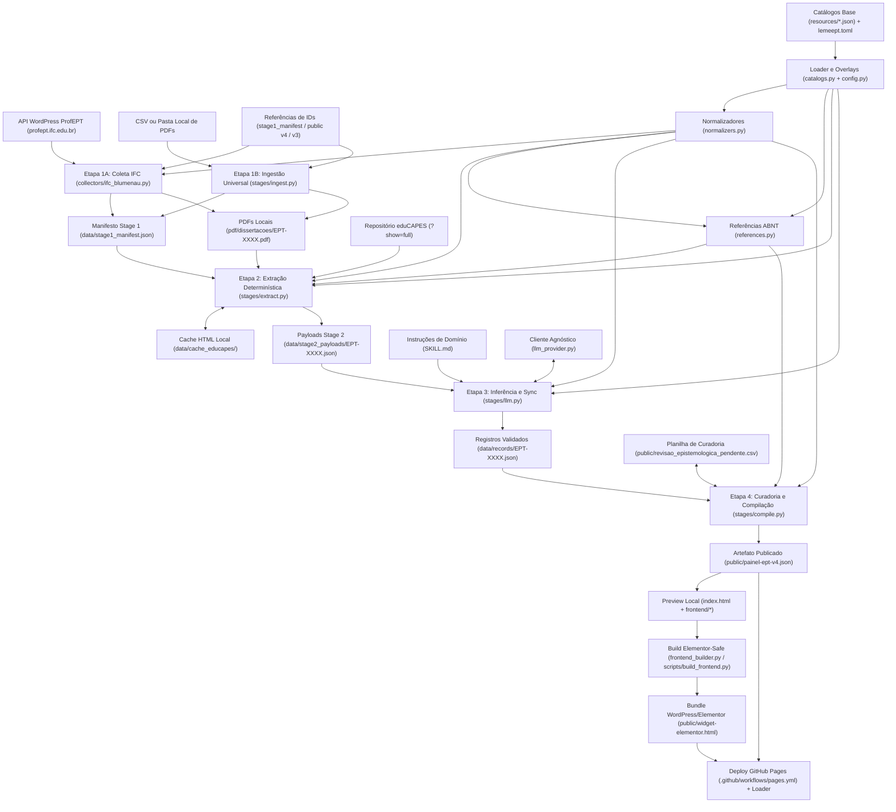

# Arquitetura e Governança — LEME / ProfEPT (`lemeept` & `lemeept-extractor`)

> **Escopo deste documento:** Visão executiva da arquitetura em 4 etapas + frontend modular, diagrama de fluxo de dados, mapa de diretórios/artefatos e regras de governança. Para detalhes de implementação interna e schemas Pydantic, consulte [DOCUMENTACAO_TECNICA.md](DOCUMENTACAO_TECNICA.md); para taxonomia de domínio, consulte [CONTRATO_DADOS.md](CONTRATO_DADOS.md).

---

## 1. Fluxo Geral de Dados

---

## 2. Estrutura Modular

O repositório separa claramente dois componentes:
- **`lemeept-extractor` ([src/lemeept_extractor/](../src/lemeept_extractor)):** pacote Python distribuível universal (`import lemeept_extractor`, CLI `lemeept-extractor`), independente da instituição.
- **`lemeept` (raiz + [collectors/](../collectors) + [config/](../config) + [frontend/](../frontend) + [public/](../public)):** portal Bússola LEME / ProfEPT com a instância de referência do IFC Campus Blumenau.

Etapas e responsabilidades:
* **Etapa 1A — Coleta WordPress IFC Blumenau ([collectors/ifc_blumenau.py](../collectors/ifc_blumenau.py)):** Consulta a API REST do WordPress do ProfEPT com acionamento explícito (`uv run python collectors/ifc_blumenau.py`), reutilizando [io_utils.py](../src/lemeept_extractor/io_utils.py) para preservação de IDs estáveis (`EPT-XXXX`), download e validação `%PDF-` / `SHA-256`. Fica fora do pacote distribuível e da CLI universal.
* **Etapa 1B — Ingestão Universal ([stages/ingest.py](../src/lemeept_extractor/stages/ingest.py) + [io_utils.py](../src/lemeept_extractor/io_utils.py)):** Gera `data/stage1_manifest.json` (`Stage1ManifestV4`) a partir de CSV (`--csv`, suportando links HTTP ou caminhos locais) ou diretório local de PDFs (`--pdfs-dir`, com extração preliminar de capa/ficha catalográfica via `extrair_metadados_preliminares_pdf`), suportando também `--somente-dissertacoes`.
* **CLI Universal e Configuração ([cli.py](../src/lemeept_extractor/cli.py) + [config.py](../src/lemeept_extractor/config.py)):** Expõe `lemeept-extractor` (`--config`, `ingest`, `extract`, `llm`, `compile`, `build-frontend`) e carrega `lemeept.toml` com overlays externos sobre os catálogos base.
* **Etapa 2 — Extração Determinística ([stages/extract.py](../src/lemeept_extractor/stages/extract.py) + [extractors/](../src/lemeept_extractor/extractors) + [references.py](../src/lemeept_extractor/references.py)):** Orquestrador enxuto que delega leitura/recorte de PDFs via `pymupdf` (`pdf_sections.py`), extração de coorientadores, palavras-chave e fallback de metadados preliminares (`metadata.py`), classificação de Macroprojeto/Linha, tipologia CAPES e formato do produto (`classifiers.py`), scraping/cache do eduCAPES (`educapes.py`) e parsing ABNT de `autores_referenciados` (`references.py`).
* **Etapa 3 — Inferência Semântica e Hidratação ([stages/llm.py](../src/lemeept_extractor/stages/llm.py) + [llm_provider.py](../src/lemeept_extractor/llm_provider.py) + [normalizers.py](../src/lemeept_extractor/normalizers.py) + [catalogs.py](../src/lemeept_extractor/catalogs.py) + [SKILL.md](../src/lemeept_extractor/SKILL.md)):** Envia JSON compacto com fragmentos relevantes ao provedor configurado (`gemini`, `groq`, `mistral`, `openrouter` ou `ollama`), aplica normalização canônica e trava de confiança (`RespostaInterpretativaLLM` ou `RespostaInterpretativaDissertacaoLLM`) e hidrata `data/records/EPT-XXXX.json`. Inclui `--sync-deterministico`.
* **Etapa 4 — Curadoria Bidirecional e Compilação ([stages/compile.py](../src/lemeept_extractor/stages/compile.py)):** Importa decisões humanas (`APROVADO` / `MANTER_NULO`) de [public/revisao_epistemologica_pendente.csv](../public/revisao_epistemologica_pendente.csv) para `data/records/`, executa reconciliação global de `autores_referenciados`, valida registros contra `ContratoDefesaV4` e `PainelEptV4Output`, publica `painel-ept-v4.json` e atualiza o CSV com as pendências restantes.
* **Frontend e Empacotamento Elementor ([index.html](../index.html) + [frontend/](../frontend) + [frontend_builder.py](../src/lemeept_extractor/frontend_builder.py) + [templates/frontend/](../src/lemeept_extractor/templates/frontend) + [scripts/build_frontend.py](../scripts/build_frontend.py) + [.github/workflows/pages.yml](../.github/workflows/pages.yml)):** Mantém HTML, CSS e Vanilla JS separados com templates parametrizáveis empacotados no wheel (`index.template.html`, `loader-elementor.template.html`), compila `public/widget-elementor.html` (zero dependências externas, CSS escopado em `#leme-painel-ept`, zero linhas em branco) e publica via GitHub Pages para carregamento via `public/loader-elementor.html` no **Widget HTML (`</>`)** do Elementor.

---

## 3. Mapa de Diretórios e Artefatos

| Caminho | Rastreamento Git | Função no Sistema |
| :--- | :--- | :--- |
| [src/lemeept_extractor/](../src/lemeept_extractor) | Rastreado | Pacote universal (`__init__.py`, `cli.py`, `config.py`, `models.py`, `catalogs.py`, `normalizers.py`, `references.py`, `io_utils.py`, `llm_provider.py`, `frontend_builder.py`, `SKILL.md`, `stages/`, `extractors/`, `resources/`, `templates/frontend/`). |
| [collectors/](../collectors) | Rastreado | Coletores de instâncias locais (`ifc_blumenau.py`), mantidos fora do wheel/sdist do `lemeept-extractor`. |
| [lemeept.toml](../lemeept.toml) / [config/](../config) | Rastreado | Perfil declarativo da instância IFC Blumenau (`config/ifc_blumenau_catalogos.json` com aliases docentes e topônimos locais). |
| [frontend/](../frontend) / [index.html](../index.html) | Rastreado | Fonte única modular do painel BI v4 (`styles.css`, `app.js` e preview HTTP local). |
| [scripts/build_frontend.py](../scripts/build_frontend.py) | Rastreado | Wrapper CLI stdlib-only sobre `lemeept_extractor.frontend_builder` para validar/gerar `public/widget-elementor.html` (`--check`). |
| [public/painel-ept-v4.json](../public/painel-ept-v4.json) | Rastreado | Catálogo bibliométrico publicado validado por `PainelEptV4Output`. |
| [public/widget-elementor.html](../public/widget-elementor.html) | Rastreado | Artefato único compactado para GitHub Pages ou colagem direta no **Widget HTML (`</>`)** do Elementor. |
| [public/loader-elementor.html](../public/loader-elementor.html) | Rastreado | Snippet enxuto (26 linhas) para colagem única no **Widget HTML (`</>`)** que carrega `public/widget-elementor.html`. |
| [public/revisao_epistemologica_pendente.csv](../public/revisao_epistemologica_pendente.csv) | Rastreado | Planilha bidirecional de curadoria humana (`;`, `UTF-8-SIG`) para bases pendentes. |
| [.github/workflows/](../.github/workflows) | Rastreado | Automação de CI (`ci.yml`: lint, testes, validação JSON/frontend, build e smoke test do wheel) e CD (`pages.yml`: publicação `_site/public/`). |
| [docs/](.) | Rastreado | Documentação técnica, contratos, relatórios empíricos e log de auditoria. |
| [tests/test_lemeept.py](../tests/test_lemeept.py) | Rastreado | Suíte de testes unitários offline (`unittest`). |
| [pyproject.toml](../pyproject.toml) / [uv.lock](../uv.lock) | Rastreado | Manifesto PEP 621 (`lemeept-extractor`, `hatchling`, Python `>=3.12`) e lockfile `uv`. |
| [LICENSE](../LICENSE) / [CITATION.cff](../CITATION.cff) / [CHANGELOG.md](../CHANGELOG.md) | Rastreado | Licença MIT, citação acadêmica (GitHub/Zenodo) e histórico de releases. |
| `dist/` / `build/` / `*.egg-info/` | Ignorado (`.gitignore`) | Artefatos de distribuição Python gerados por `uv build` (`.whl` / `.tar.gz`). |
| `pdf/dissertacoes/` | Ignorado (`.gitignore`) | PDFs das dissertações baixados localmente (`EPT-XXXX.pdf`). |
| `data/` | Ignorado (`.gitignore`) | Artefatos intermediários (`stage1_manifest.json`, `cache_educapes/`, `stage2_payloads/`, `records/`). |
| `.env` / `.venv/` | Ignorado (`.gitignore`) | Chaves locais de API e ambiente virtual gerenciado pelo `uv`. |

---

## 4. Regras de Governança e Invariantes

1. **Cardinalidade e Modo Somente Dissertações:** No fluxo padrão ProfEPT, `1 Defesa = 1 Dissertação + 1 Produto Educacional` (`total_producoes = total_defesas * 2`). Em acervos sem produto educacional vinculado (`sem_produto: true` / `produto: null`), `total_producoes = total_defesas + defesas_com_produto`.
2. **Vínculo Taxonômico Rígido:** O Macroprojeto (`MP1`..`MP6`) determina obrigatoriamente a Linha de Pesquisa (`MP1–MP3 → LP1`; `MP4–MP6 → LP2`) por regra determinística, sem inferência livre.
3. **Trava de Confiança e Vocabulário Canônico:** `base_epistemologica` exige evidência localizável (`secao`, `pagina`, `trecho`) e conformidade com o vocabulário canônico. Apenas candidatos com `confianca == "alta"` válidos preenchem `valor`; os demais mantêm `valor: null` e `revisao_pendente: true`.
4. **Proteção à Curadoria Humana:** Registros curados via CSV recebem `curado_humano: true` e nunca são sobrescritos por reexecuções padrão ou `--sync-deterministico` (exigindo `--sobrescrever --forcar-curados`).
5. **Hierarquia de Fontes para Tipologia de Produto:** O formato específico declarado na dissertação/ficha do produto (`dissertacao_ficha`) prevalece sobre os metadados do eduCAPES (`educapes_dc_type`) e sobre a inferência assistida (`inferencia_llm`).
6. **Invariante Stdlib no Build do Frontend:** `lemeept_extractor/__init__.py` e `lemeept_extractor/frontend_builder.py` não devem importar dependências de terceiros, preservando a execução rápida de `scripts/build_frontend.py --check` no workflow do GitHub Pages sem instalar `.venv`.
